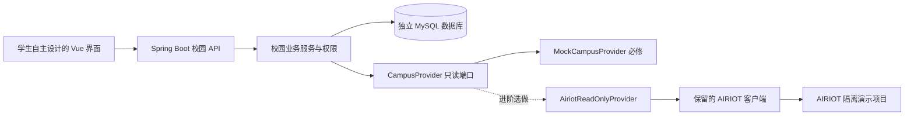

# 项目范围与教学架构

## 从现有平台得到什么

现有系统的业务链路是管理端 MG → 后端 BE → AIRIOT，本地数据库另外保存校园映射、演练事件、责任关系和审计。课程采用同样的问题域与主要技术栈，但在独立工程中建立学生可理解、可离线复现的最小业务系统。

原系统的`AiriotClient`保留为教师理解上游协议的参考。独立教学工程已经实现CampusProvider端口、MockCampusProvider和AiriotReadOnlyProvider边界；后者保持未配置/未连通状态，不假装完成真实接入。教学工程独立存放，没有为本课程改写原学校系统的账户、配置或业务记录。

## 教学工程架构



图中端口与教学模拟实现已在resources/campus-ai-course落地；AIRIOT分支表示保留的扩展边界，真实客户端接线与外部验证属于选做。控制写入不属于该只读端口，基础工程不暴露远端控制入口。

## 模块分工

| 模块 | 教师准备 | 学生实现与验证 |
| --- | --- | --- |
| 项目基础 | 依赖、配置示例、构建和测试入口 | 运行、理解目录、提交版本、排查差异 |
| 身份认证 | 登录会话、CSRF、四身份、当前角色授权、响应门控 | C08严格能力；核验三角色、本人范围、过期及拒绝 |
| 数据源 | 数据端口、固定模拟/历史、DTO、图表与轮询 | C07质量优先级；核对零/null、时间、单位与来源 |
| 空间设备 | 完整读接口、校园/楼栋创建、Mapper与事务 | C05引用存在性；写入、独立回读和拒绝 |
| 前端 | 页面、请求、资源状态、详情及三态基础 | 04解包/标签、C06筛选、C12分页归零、自主UI |
| 事件责任 | 状态动作、行锁/事务、时间线与表单 | C09关闭门槛、C10版本比较；闭环与责任影响范围 |
| 质量交付 | 独立数据、真实MySQL测试设施、逐章起点与验收表 | C11独立断言、按证据修复、复现与个人解释 |

教师目录保留完整参考答案；学生每份章节起点只缺当前关键任务，其他章节代码预置。每章完成不能宣称整套平台由本人从零写成。安全底层不让初学者依靠大模型从零发明，学生仍须亲自验证并解释拒绝边界。

## 数据设计原则

模拟组件提供空间、设备、采集点、历史和只读原始报警；本地数据库存校园/楼栋、空间绑定、事件、事件时间线、设备责任和责任时间线。源设备 ID 作为本地记录的引用，业务写入不修改外部设备目录。

现有教学数据集采用4空间、16设备、28点的规模，便于与参考系统比较。固定目录已提供，但不能将预期规模硬编码成界面的“实际数量”。所有夹具使用独立教学标识；不复制现有项目 ID、真实账号、受限配置或生产数据。

时间统一为 epoch 毫秒。数据来源使用 `TEACHING_MOCK` 或 `AIRIOT`；`simulated` 描述对象是否模拟。教学模拟和真实平台中的模拟设备都必须显示模拟标识。点质量区分 fresh、stale、missing、invalid；网络失败还需单独描述，不能把失败伪装成空列表。

## 保持同一份合同

前端类型、后端 DTO、模拟返回和测试预期以 [教学接口约定](contracts/教学接口约定.md) 为共同依据。改变字段必须先更新合同和例子，再修改实现、测试及接力文件。原系统合同仍是参考，不应为了适应新教学设计而改写现有系统历史。

只读数据源由启动配置明确选择。AIRIOT 超时、鉴权失败或结构异常时返回可解释的错误，不自动切到教学数据。模拟模式可以显式注入故障，用于学习异常处理，但界面不能声称读取了实际设备。

## 如何逐步搭建

1. 先定义一条最小业务切片：读取两台模拟设备并显示名称、类别和未知通信状态。
2. 加入空间映射和设备筛选，让学生建立接口、持久化与 UI 的联系。
3. 增加采集值和历史，训练时间、单位、缺失数据和错误处理。
4. 将通用登录身份落实为三角色与“本人事件”授权。
5. 引入一个完整的演练事件流程，再增加责任登记和自动分派。
6. 用独立测试检验失败、冲突和回滚，最后交付与变更。

每个阶段对应明确的文档或代码检查点；完整参考已有作者技术验证。学生ch04—ch12起点由生成器从冻结版本制作，只挖本章任务并保留预期失败；发布以起点生成和检查清单为准。作者报告与学生实际成果分栏，不预填个人成功。

## 环境和目录

完整教师参考已在resources/campus-ai-course落地：第04章使用first-chain，05—12章使用teacher-db；逐章学生副本另在resources/student-chapters。V0.4首次链路保留为历史资源。

```text
campus-ai-course/
  frontend/       Vue 工程与前端测试
  backend/        Spring Boot 工程与后端测试
  fixtures/       教学数据和可控故障输入
  docs/           需求、合同、任务和交接
  evidence/       脱敏的实际运行与验收记录
```

已确认学生自带Windows/macOS电脑，数据库由教师提供；每组使用隔离schema，不要求学生自行安装容器。首次链路暂不连接数据库，采用单实例HttpSession，无Redis。macOS与Windows实机须分别留下实际复现证据。

现有项目的 `local-runtime.py` 面向当前 macOS 和专属目录，不能作为 Windows 学生的一键安装包直接分发。教学工程采用独立配置与端口，实际启动前检查占用；不连接现有学校 DEMO 的数据库或账号。
