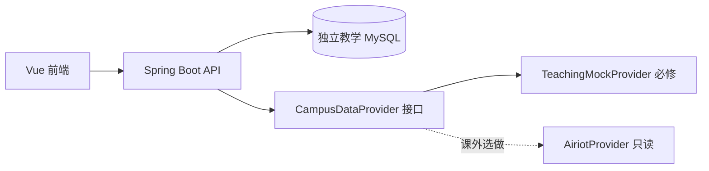

# 第03章 架构、数据与接口设计

状态：`DESIGNED`。课内 4 学时，按 1＋2＋1 分配。文中教学类名和目录为待实现设计，不表示现有平台已经具备相同抽象。

## 进入条件与学习目标

已有第02章需求基线。教师须准备简化合同样例、种子数据说明及接口评审模板，均待制作。学生完成后能画出前端、后端、数据源的边界；区分外部观测数据与本地业务记录；能解释 DTO、数据表、API 合同分别解决什么问题；能检查空值、单位、版本和状态规则。

## 模块一：划分职责与替换数据源（1 学时）

前端负责呈现和交互，后端负责授权、校验、业务规则与持久化，数据源负责提供观测。技术栈沿用 Vue 3、TypeScript、Vite、Pinia、ECharts，以及 Java 17、Spring Boot 3.4.2、MyBatis、Flyway、MySQL；教师冻结依赖，课堂不追逐新版本。



这三个 Provider 名称是教学设计。模拟实现使用确定性种子与可控时钟；真实上游失败必须报错，不能静默换成模拟成功。认证基础由教师预制并验证，学生学习和实现业务授权，不从零发明密码与令牌方案。

产出：一张架构图和各组件的输入、输出、责任说明。

## 模块二：从业务名词到数据合同（2 学时）

空间、设备、采集点描述观测对象；本地事件、设备责任与时间线描述本组系统产生的业务事实。DTO 是跨接口交换的数据形状，数据库实体是持久化结构，两者不应因为名字相似就直接全部互相暴露。

先设计最小读接口：`GET /campus/spaces` 与 `GET /campus/devices`，均返回 `{code:0,message,data:{items,observedAt}}`。时间采用 epoch 毫秒，可空字段用 `null`。设备保留 `id`、`tableId`、`name`、`category`、`spaceId`、`spaceName`、`online`、`communicationTime`、`simulated`、`switchOn`、`tags`；四类 category 沿用 `environment/energy/facility/lighting`。不要为省事把未知通信状态设为 false。

概览接口 `/campus/overview` 增加 `source:TEACHING_MOCK|AIRIOT` 与 `simulated` 等合同字段；source 表示数据来自哪种提供器，simulated 表示对象是否模拟，二者不能合并。初次贯通只需一空间、两设备，最终规模为四空间、十六设备、二十八点；期望数不能冒充实际返回数。

为后续章节预留四类本地记录：事件主记录、事件时间线、设备责任主记录、责任时间线。事件状态是 `NEW→ASSIGNED→IN_PROGRESS→CLOSED`，来源状态另有 `ACTIVE/RECOVERED/UNKNOWN`；重新分派未关闭事件会回到 ASSIGNED，新负责人须重新开始处理。责任变更只影响随后创建事件的自动分派。

事件更新与责任登记请求携带非负 JSON 整数 `expectedVersion`，不能用数字字符串、浮点或布尔值替代；校园创建、空间绑定按各自合同，场景触发为空 body 或 `{}`，不添加版本字段。后端事务锁定并比较版本，再同时更新主记录和时间线；版本或状态冲突返回 409。前端保留输入、回读最新记录，不自动重放或显示未确认成功。事件创建版本为 1；未配置责任行版本为 0。操作者、时间和核实结论由后端产生，不能接受客户端伪造。教师在资源制作阶段统一迁移编号，已应用的 Flyway 迁移不能改写。

产出：字段字典、最小 API 合同、数据关系图和待后续实现的约束清单。

## 模块三：合同评审与样例推演（1 学时）

一人扮演前端、一人扮演后端，只通过合同解释“加载成功、空列表、不可用、旧版本提交”四种场景。检查响应外层 `{code:0,message,data}` 是否一致，错误响应是否仍保留正确 HTTP 状态，而非一律包装为 HTTP 200。

用有效零值、null、过期样本推演展示。质量保留 `fresh/stale/missing/invalid`；V、kW、kWh 不互换。关闭必须同时满足处置记录、来源已恢复、服务端独立核实 PASS、非空结论和有效权限/版本，不能只检查 state。

产出：合同评审记录与两个合法、两个非法请求样例；本章只推演，不宣称数据库并发或回滚已经验证。

## 最小实验步骤

1. 从需求中圈出空间、设备、人员、事件、责任等名词，确定关系。
2. 为一空间两设备编写 JSON 样例，至少有一个 `online:null`。
3. 对照读接口字段，补齐外层响应和时间格式，不能携带真实账户资料。
4. 写事件版本 3 的修改请求与旧版本 2 请求，分别标明预期行为。
5. 互换合同，让另一组仅据文档判断能否实现客户端。

## 可复制的网页 AI 提示

```text
请审查我的教学版智慧校园API合同，只指出冲突和缺项，不生成整套代码。
外层为{code:0,message,data}；时间epoch毫秒；未知用null。
监测source仅TEACHING_MOCK或AIRIOT，simulated是独立字段。
事件为DEMO/LOCAL_DEMO；处置状态NEW、ASSIGNED、IN_PROGRESS、CLOSED。
来源恢复与处置关闭独立；关闭还需处置记录、独立核实PASS及结论。
事件更新与责任登记用非负JSON整数expectedVersion，冲突409；主记录与时间线同事务。
场景触发为空body或{}；其他写接口不自行增加合同外版本字段。
请输出“字段或规则、问题、对前后端影响、建议修订”，不要虚构实测结果。
合同：[粘贴自己的字段表、接口及样例]
```

## 人工检查点与验收

| 验收项 | 预期证据 |
| --- | --- |
| 边界明确 | 前端不直连 AIRIOT；Provider 可替换且无静默回退 |
| 读合同一致 | 两设备样例完整，空值、时间、响应外层正确 |
| 业务事实分离 | 来源状态、处置状态、责任关系各自解释 |
| 并发规则准确 | 旧版本409，主记录与时间线原子提交的设计说明 |
| 数据诚实 | 有效零与未知分开，单位和模拟标记保留 |
| 范围正确 | 原始 AIRIOT 报警只读，不混入本地演练事件 |

## 典型错误及定位

- 前后端字段同名不同义：逐项对照字段字典和 JSON 样例。
- 把恢复当关闭：画两条状态轴，回查独立核实及关闭门槛。
- 把版本当时间戳：说明版本表示已确认业务修改次序，不由客户端自行递增后强写。
- 把 DTO 直接当用户实体输出：删除合同外账户与秘密字段，采用明确字段映射。

## 课后巩固、进阶选做与下章接力

课后修订合同并给每个字段补类型、是否可空、来源和例子。选做：为提供器写接口伪代码及失败情形，不连接真实 AIRIOT。

下一章交付架构图、合同版本、种子样例和待决项。只有教师完成脚手架制作并验证后，才将这些合同用于首次本机贯通；本章材料本身不是可运行代码。
