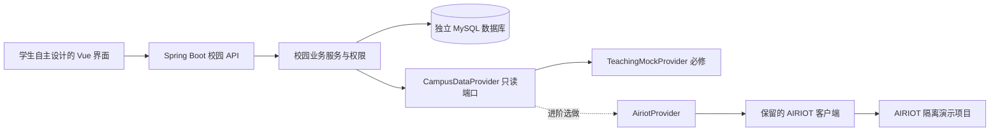

# 项目范围与教学架构

## 从现有平台得到什么

现有系统的业务链路是管理端 MG → 后端 BE → AIRIOT，本地数据库另外保存校园映射、演练事件、责任关系和审计。课程采用同样的问题域与主要技术栈，但在独立工程中建立学生可理解、可离线复现的最小业务系统。

现有 `AiriotClient` 可以作为适配参考，尚没有现成的 `TeachingMockProvider` 切换机制。部分服务直接依赖该客户端，前端来源类型也限定为 AIRIOT。因此“保留 AIRIOT 组件”需要接口抽取和合同调整，不是把一个配置改成 mock 即可。当前课程文档未修改这些源文件。

## 拟定架构



以上类名是教学设计，需在制作配套工程时实现。控制写入不属于该只读端口，基础工程也不暴露远端控制入口。

## 模块分工

| 模块 | 教师准备 | 学生实现与验证 |
| --- | --- | --- |
| 项目基础 | 依赖、配置示例、构建和测试入口 | 运行、理解目录、提交版本、排查差异 |
| 身份认证 | 标准框架实现的登录会话、密码处理与账户种子 | 三角色业务授权、对象范围、过期及拒绝行为 |
| 数据源 | 数据端口、模拟实现和故障模式 | 调用合同、转换 DTO、正确展示质量与来源 |
| 空间设备 | 空模块和一条最小接口示范 | 设备读取、查询参数、空间映射持久化 |
| 前端 | 路由和请求基础、最小布局 | 页面、组件、筛选、详情、状态和自主视觉设计 |
| 事件责任 | 数据迁移与测试模式示例 | 状态机、处理规则、责任登记、版本及时间线 |
| 质量交付 | 独立验收数据、测试模板、干净环境 | 设计测试、执行、修复、复现和交接 |

教师样例不直接给出所有状态机业务答案；对框架配置提供成熟基线，对本课程关键规则保留学生任务。安全相关底层不让初学者依靠大模型从零发明。

## 数据设计原则

模拟组件提供空间、设备、采集点、历史和只读原始报警；本地数据库存校园/楼栋、空间绑定、事件、事件时间线、设备责任和责任时间线。源设备 ID 作为本地记录的引用，业务写入不修改外部设备目录。

最终数据集采用 4 空间、16 设备、28 点的规模，便于与参考系统比较。它是教学目标规模，不能硬编码成界面的“实际数量”。制作脚手架时使用独立教学标识；不复制现有项目 ID、真实账号、受限配置或生产数据。

时间统一为 epoch 毫秒。数据来源使用 `TEACHING_MOCK` 或 `AIRIOT`；`simulated` 描述对象是否模拟。教学模拟和真实平台中的模拟设备都必须显示模拟标识。点质量区分 fresh、stale、missing、invalid；网络失败还需单独描述，不能把失败伪装成空列表。

## 保持同一份合同

前端类型、后端 DTO、模拟返回和测试预期以 [教学接口约定](contracts/教学接口约定.md) 为共同依据。改变字段必须先更新合同和例子，再修改实现、测试及接力文件。原系统合同仍是参考，不应为了适应新教学设计而改写现有系统历史。

只读数据源由启动配置明确选择。AIRIOT 超时、鉴权失败或结构异常时返回可解释的错误，不自动切到教学数据。模拟模式可以显式注入故障，用于学习异常处理，但界面不能声称读取了实际设备。

## 如何逐步搭建

1. 先定义一条最小业务切片：读取两台模拟设备并显示名称、类别和未知通信状态。
2. 加入空间映射和设备筛选，让学生建立接口、持久化与 UI 的联系。
3. 增加采集值和历史，训练时间、单位、缺失数据和错误处理。
4. 将通用登录身份落实为三角色与“本人事件”授权。
5. 引入一个完整的演练事件流程，再增加责任登记和自动分派。
6. 用独立测试检验失败、冲突和回滚，最后交付与变更。

每个阶段都产生可运行检查点。检查点必须在未来教学工程实测后发布，目前不预填成功报告。

## 环境和目录

拟定教学工程结构如下；本轮交付的 Markdown 包不包含这些程序文件。

```text
campus-ai-course/
  frontend/       Vue 工程与前端测试
  backend/        Spring Boot 工程与后端测试
  fixtures/       教学数据和可控故障输入
  docs/           需求、合同、任务和交接
  evidence/       脱敏的实际运行与验收记录
```

教师制作时须实测 Windows 和 macOS 的命令差异、学校机房权限与数据库运行条件。数据库建议采用统一的隔离教学环境；若使用容器，必须先验证机房支持，不能将容器默认当成所有学生已具备的条件。Redis 是否随认证基础保留，由脚手架制作阶段一次确定并写入版本说明，不要求学生额外学习其运维。

现有项目的 `local-runtime.py` 面向当前 macOS 和专属目录，不能作为 Windows 学生的一键安装包直接分发。教学工程采用独立配置与端口，实际启动前检查占用；不连接现有学校 DEMO 的数据库或账号。
