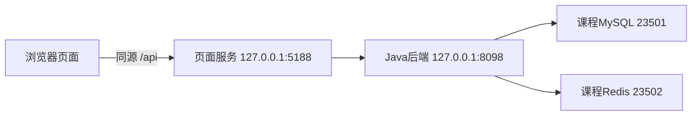

# 项目范围与教学架构 · V2.1.0

学生在同一个`campus-lab`中从空白HTML开始。前六课用HTML、CSS、JavaScript和公开教学样本完成九菜单；后六课在原工程逐步加入Java17/Spring Boot后端。MySQL保存业务，Redis保存短时会话；浏览器不直连数据库。

图中数据库端口是课程默认值，数据与配置只属于本工程。Docker主路线与macOS/Linux原生备用路线实现同一业务边界；已选路线从第08课到交付保持一致。原生后端读取`DB_URL`、`DB_USER`、`DB_PASSWORD`、`REDIS_PORT`等环境覆盖项，适配教师确认的本机环境。具体准入、初始化和停止方式见[环境准入与备用路线](handbook-v2/engineering/07-环境准入与备用路线.md)。Windows无Docker时需教师提供已验收实验机。

| 阶段 | 当前数据与权限来源 | 本阶段不能宣称的结果 |
| --- | --- | --- |
| 01–02 | 公开样本、异步data-service、页面状态 | 真实校园接入或数据库保存 |
| 03–06 | 浏览器本机保存与演示身份 | 后端认证、全班共享数据库、真实权限已验收 |
| 07 | 仅Java health与连接失败检查 | 业务接口或数据库已接通 |
| 08 | MySQL空间/设备，其他分区仍演示 | 九菜单全部完成联调 |
| 09 | MySQL账号、BCrypt、Redis短时会话；真实设备读取 | 尚未实现的空间/责任/事件写权限已通过 |
| 10–11 | 逐项接通业务接口、后端权限、版本与审计 | 设备控制、外部通知或真实校园故障恢复 |
| 12 | 新目录独立配置与数据，接手者实际操作 | 未实测的其他操作系统或另一台电脑已经可用 |

4空间、16设备、28点均为公开教学样本。数值0不等于缺失，kW不等于kWh；来源、采样时间、质量和模拟标记必须贯穿页面与后端。原始报警只读，本地演练独立，模拟恢复、核实、关闭分别处理。不提供真实设备控制或外部通知。

学生根据需求写最小用例、实体关系和接口样例，再用它们检查生成代码。后端按controller/service/query或对应数据访问层分工；持久化修改采用新迁移，不覆盖已执行迁移。成功写入后独立回读，权限最终由后端判定；`expectedVersion`冲突后回读并人工重新决定，不自动重放旧请求。

前端内存保存登录token，整页刷新需重新登录；模式偏好不等于身份。密码只在本机配置与本人登录输入中使用，公开交付不含`.env`、token、运行目录或数据库。每项设计的理由与字段约定可查[需求规格与用例](handbook-v2/engineering/01-需求规格与用例.md)、[架构与设计取舍](handbook-v2/engineering/02-架构与设计取舍.md)、[数据模型与字典](handbook-v2/engineering/03-数据模型与字典.md)和[API接口手册](handbook-v2/engineering/04-API接口手册.md)。

`resources/from-zero-v2/student-start`是学生起点；`teacher-reference`仅用于教师对照与卡点定位。仓库的完整示范系统`system/`供深入阅读，学生不必在48学时内复刻其全部生产适配。课堂按教学合同与实际业务行为验收，不要求逐字复制教师源码。
