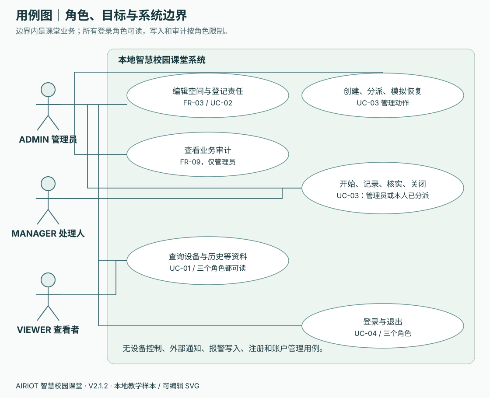

# 工程手册一：需求规格与用例 · V2.1.1

先回答“谁需要做什么、怎样才算完成”，再让 AI 写代码。本手册是本地课堂系统的需求基线；12 课仍为 48 学时、64 个操作步骤。阅读、讨论和记录安排在对应步骤内，不另加操作步骤。这里的验收目标需要由你的实际结果证明，不能把文档中的目标抄成“已通过”。

## 你要做什么

第01课开始前，用自己的话复述下面的系统边界；第06课串联前端时，选择一个用例与同伴对演；第07课整理页面数据时，把需求 ID 写入已有 `docs/页面需要的数据.md`；第12课用相同 ID 对照交付结果。

产出是 `docs/需求与用例.md`：九项功能各一行实际实现位置、一个完整用例的实际操作记录、一个失败分支、尚未完成项。允许 AI 帮助排版，角色、条件和结果由学生核对。

## 1. 系统边界与目标

目标：用公开教学样本搭出九菜单管理台，逐步从浏览器演示迁移到自己的 Java 后端，使空间登记、设备责任、演练闭环和审计能保存、回读并按角色控制。

| 范围 | 本课程约定 |
| --- | --- |
| 数据 | 4 个空间、16 台设备、28 个点位，全部为 `TEACHING_MOCK`；即使进入 MySQL，也仍是教学样本 |
| 用户与运行环境 | 一台电脑上的课堂练习；三种教学角色；学生自行启动本课程服务 |
| 包含 | 浏览查询、空间楼栋/楼层编辑、设备责任登记、独立演练事件、短时登录、业务审计、源码交接 |
| 原始报警 | 只能读取样本，保留原状态和等级；没有确认、关闭、删除报警的业务 |
| 演练事件 | 与原始报警分开保存；创建和恢复只改变本地演练记录，不说明实际设备异常或恢复 |
| 不包含 | 真实校园接入、设备远程控制、短信/邮件通知、注册/找回密码/用户管理、计费、能耗结算或节能率 |
| 课程阶段 | 第01–06课角色与写入为浏览器演示；第07课健康检查；第08课起分项接 MySQL；第09课登录；第11课完成后端闭环 |

前端的“隐藏按钮”帮助用户理解权限，最终授权必须在后端。原始报警与演练事件可以指向同一设备，但本课程没有“报警自动转事件”的关系。未知值不能补为 0，功率 kW、电压 V 不能当作电量 kWh 或费用。

## 2. 角色和用例总览

| 操作 | ADMIN 管理员 | MANAGER 处理人 | VIEWER 查看者 |
| --- | --- | --- | --- |
| 读取设备、空间、读数、历史、原始报警、责任、事件、接入说明 | 可以 | 可以 | 可以 |
| 编辑空间、登记责任、创建或分派事件、模拟恢复来源 | 可以 | 不可以 | 不可以 |
| 开始、记录、核实、关闭事件 | 全部符合条件的事件 | 仅分派给自己的事件 | 不可以 |
| 查看业务审计 | 可以 | 不可以 | 不可以 |

所有人都有读取全部教学事件的权限；“本人已分派”限制的是处理权。参考工程固定三账号 `admin/manager/viewer`，责任人和被分派人仅使用 `manager`。这不是生产系统的账户方案。

## 3. 功能需求清单

| ID / 菜单 | 学生能完成什么 | 可观察的验收结果 | 主要课次 |
| --- | --- | --- | --- |
| FR-01 概览 | 查看样本总体情况并进入设备页 | 数量由实际集合得到；16 台设备、4 空间、28 点；来源标识可见 | 01、10 |
| FR-02 设备 | 筛选设备、看同一设备详情 | 四类各4台；`online=true/false/null` 分别表达在线、离线、未知；跨页保留 ID | 02、08、10 |
| FR-03 空间 | 查看设备所属空间；管理员编辑楼栋和楼层 | 非空输入保存后回读；刷新后保留；其他角色写入被拒 | 03、10 |
| FR-04 能源 | 比较能源设备的功率、电压及对应历史 | 只含4台能源设备；单位与点位一致；没有凭空计算 kWh/费用 | 04、10 |
| FR-05 历史 | 查看选定设备和点位样本 | 0 保留、null 断线；不插值补造缺失；设备/点位切换不会串数据 | 05、10 |
| FR-06 原始报警 | 搜索、查看原始样本与关联设备 | 原状态/等级不被改写，没有操作报警的按钮或写接口 | 05、10 |
| FR-07 演练事件 | 建立、分派、开始、记录、模拟恢复、核实、关闭 | 按状态和角色执行；成功版本加1；关闭条件齐全；刷新可读时间线 | 06、11 |
| FR-08 设备责任 | 管理员为设备登记处理人和说明 | 首次 expectedVersion=0；更新使用已读版本；旧版本409；成功回读 | 03、10 |
| FR-09 管理 | 看角色职责、接入说明；管理员看审计 | 来源仍为教学样本；控制/通知关闭；业务成功修改有对应审计 | 06、09、11 |
| FR-10 登录与退出 | 建立/注销短时会话 | 登录后身份来自后端；退出/刷新/会话失效后重新登录 | 09 |
| FR-11 新目录交付 | 同伴从说明运行自己的交付副本 | 生成自己的配置、隔离课程卷；公开包无真实配置和运行缓存 | 12 |

## 4. 用例规格：用条件和分支代替一句“实现功能”

### UC-01 查询设备并查看历史（FR-02、FR-05）

- 参与者：任一读取角色；第01–06课使用演示身份。
- 前置条件：页面可访问，公开样本已准备；后端模式下会话有效。
- 主流程：打开设备台账 → 筛选能源设备 → 选 d05 → 选择 power → 进入历史 → 核对设备、点位和 kW 单位。
- 备选流程：把点位改为 voltage，单位和历史随之更新，旧请求不能覆盖新的选择。
- 异常流程：读数为 null 时展示缺失；请求失败时解释失败并允许重试，已有旧结果必须标“上次成功结果”。
- 后置条件：只读取数据，没有写入或产生演练事件。

### UC-02 登记设备责任（FR-08）

- 参与者：ADMIN。
- 前置条件：已登录；设备存在；先 GET 读取现有责任，若无记录则使用版本0。
- 主流程：选择设备 → 责任人填 manager → 写非空说明 → 提交 expectedVersion → 后端保存并增加版本 → 独立 GET 回读 → 显示成功。
- 备选流程：已有记录时使用最新版本更新；该登记影响后续创建事件的默认分派，不自动转移旧事件的处理人。
- 异常流程：VIEWER/MANAGER提交返回403；空说明或非法责任人返回400；旧版本409后回读，由学生重新决定，不自动重发。
- 后置条件：责任记录和成功审计在同一事务中保存。

### UC-03 完成一次演练闭环（FR-07、FR-09）

- 参与者：ADMIN、该事件的 MANAGER；VIEWER用于核对只读。
- 前置条件：设备存在；账号已登录；始终使用当前事件的已读版本。
- 主流程：管理员给无责任人的设备创建事件（NEW）→ 分派给 manager（ASSIGNED）→ 处理人开始（IN_PROGRESS）→ 填处置记录 → 管理员模拟恢复来源 → 处理人独立核实 → 填关闭结论并关闭（CLOSED）→ 回读时间线和管理员审计。
- 备选流程 A：设备已有责任人时，创建后直接 ASSIGNED，略过首次分派。
- 备选流程 B：管理员也能执行开始、记录、核实和关闭；参考实现允许 NEW/ASSIGNED 阶段重新分派给 manager，开始后不允许重新分派。
- 异常流程：未分派先开始、条件不齐先关闭、关闭后再修改均拒绝；无权角色403；旧版本409。发生失败时记录不增加版本、不写成功审计。
- 后置条件：原始报警和设备不被改变；事件主记录、内嵌时间线、审计一致保存。恢复、核实、关闭是三个不同动作。

### UC-04 登录并在失效后恢复（FR-10）

- 参与者：三种本地教学账号。
- 前置条件：MySQL、Redis、后端已启动；学生只在本机查看自己的练习口令，不分享它。
- 主流程：提交用户名/口令 → 后端校验 MySQL 中的 BCrypt 摘要 → Redis保存1800秒会话 → 浏览器内存保存令牌 → GET /api/me确认身份 → 读取业务。
- 备选流程：主动退出删除当前会话；浏览器清理内存身份与受保护内容。
- 异常流程：口令错误/令牌失效401；Redis不可用503；刷新页面后因内存令牌消失需要重新登录，MySQL业务资料仍保留。
- 后置条件：口令、令牌不进入交付记录、浏览器永久存储或日志。

## 5. 非功能验收目标

这些是本机课堂验收门槛，不是生产 SLA，也不代表本版新增内容已完成真人课堂验证。记录电脑环境、测试条件和实际结果；失败写失败。

| ID / 目标 | 测量或操作方法 | 通过条件 |
| --- | --- | --- |
| NFR-01 权限与身份 | 用 VIEWER分别提交空间、责任、事件写请求；退出后再读设备 | 每项拒绝写入；退出后401；不只检查按钮隐藏 |
| NFR-02 保密与边界 | 查看交付文件清单、浏览器存储；访问页面服务的私密路径 | 无真实.env/口令/token；令牌只在内存；页面服务只公开frontend |
| NFR-03 等待与反馈 | 后端停止后点读取；对照网络面板及页面；检查响应头已到但正文停住的离线回归 | 有明确错误和重试；从发请求到完整读取正文共用前端约5秒上限，不能无限转圈；不宣称后端5秒内一定完成 |
| NFR-04 持久保存 | 记录设备、空间/责任/事件；按正文停止后端并重启本课程MySQL | 恢复后同一记录和版本仍在，不通过删卷重新初始化获得“通过” |
| NFR-05 并发一致性 | 同一责任/事件保留旧版本，再成功修改一次后提交旧版本 | 返回409；版本只增加一次；学生回读后重新决定 |
| NFR-06 数据含义 | 检查真实0、缺失null、失效质量及不同单位 | 无补零、无伪造恢复、无 kW→kWh/费用推断；样本标识保留 |
| NFR-07 失败恢复 | 首次加载失败、成功后加载失败、恢复后重试各做一次 | 首次显示错误；旧结果明确标旧；恢复后清除旧错误，不能静默退回mock |
| NFR-08 交接可复现 | 同伴在新目录按README操作 | 使用独立项目名/卷与本地配置完成启动及闭环；写明操作系统和未验证项 |
| NFR-09 可解释性 | 不读AI回复，口述一次请求、状态变化和一条拒绝规则 | 能指到实际代码/请求/记录，解释“为何失败”和“怎样确认成功” |

## 6. 本页验收与依据

请同伴随机问你：“原始报警能关闭吗？”“处理人能改其他人的事件吗？”“为什么设备已有责任人时不从 NEW 开始？”“哪一项结果能证明保存到数据库？”你应能指出需求 ID、用例分支和自己的证据，而不只是说“AI已经做好”。

本页依据学生起点的[约定卡](../../resources/from-zero-v2/student-start/materials/约定卡.md)、教师参考的 `CampusController`、`CampusService`、`CaseRules`、`User`、`AuthService` 及前端数据层。状态与数据模型见[数据模型](03-数据模型与字典.md)，具体请求见[API手册](04-API接口手册.md)。参考源码是对照材料，不替代学生自行完成的产出和验收。
