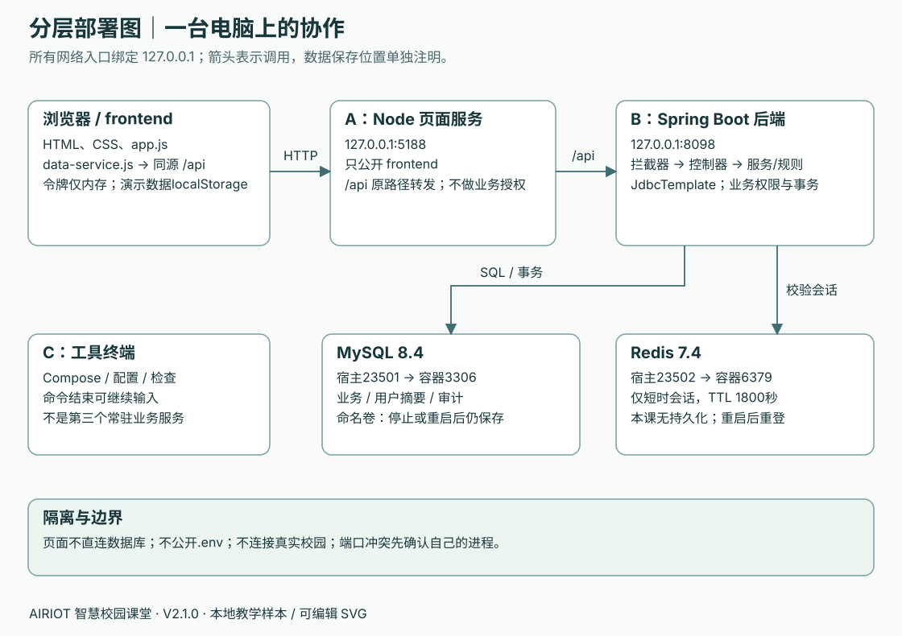
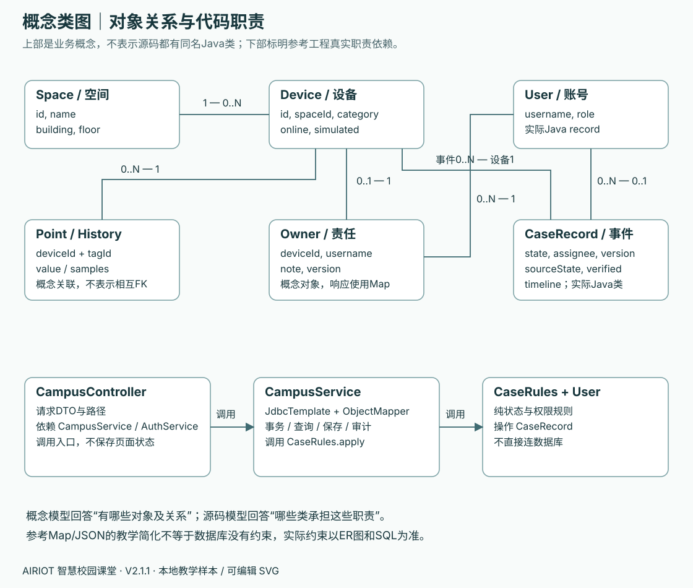

# 工程手册二：架构与设计取舍 · V2.1.0

一张页面背后有几个程序？记录存在哪里？哪个程序有权决定“可以关闭”？本页帮助你把课堂操作连成一张图。它描述本包的学生课程与教师参考工程，不描述仓库外层的最大示范系统。

## 你要做什么

第01课说明 A-页面做什么；第07课在已有 `docs/后端启动笔记.md` 画出一次健康请求；第08–09课标出 MySQL 与 Redis 的保存内容；第11课解释一个事件写入为什么需要事务。产出写入 `docs/模型说明.md` 的“架构与取舍”子节：一张自己标注的部署图、一次请求的逐站说明、两项取舍及其代价。

验收时请同伴停掉自己的 B，然后由你预测哪些页面还可打开、哪些请求会失败，并用实际现象修正说明。不要停止其他人的服务。

## 1. 本机组件、端口与信任边界

| 组件 | 入口与职责 | 保存什么 |
| --- | --- | --- |
| 浏览器 | 打开 `http://127.0.0.1:5188`，呈现页面、发请求 | 前期演示数据在localStorage；后端模式令牌只在内存；模式偏好可持久保存 |
| A：Node页面服务 | `tools/serve.mjs`，5188；只提供frontend；同源 `/api/*` 转发至8098并保留/api | 不保存业务数据，不校验业务角色 |
| B：Spring Boot后端 | 8098；验证身份、参数、角色、状态与版本；执行SQL及事务 | 业务写入MySQL，会话读取Redis |
| Docker MySQL | 本机23501映射容器3306；数据库campus_course | 业务资料与账号摘要；专属命名卷持久保存 |
| Docker Redis | 本机23502映射容器6379 | 1800秒短时会话；本课程明确关闭RDB/AOF持久化 |
| C：工具终端 | 在项目根运行配置、Compose、检查命令 | 终端本身不是一个业务服务，也没有独占的网络端口 |

以上网络服务绑定本机回环地址。`127.0.0.1`指当前电脑；同学电脑上的相同地址指向同学自己的服务。网页只接触同源 `/api`，不会直接连MySQL或Redis，也不能携带数据库口令。

**为什么用这些端口？** 5188/8098区分页面和后端；23501/23502为本课程数据库使用独立宿主机端口，便于与已有默认3306/6379区分。数字本身没有业务含义，也不能保证永不冲突。遇到占用先确认自己的A/B和课程容器；不杀未知进程，不随意只改其中一处。改变端口需要同步代理、后端、Compose和启动说明。

**为什么分A/B/C？** A与B是前台常驻程序，启动后一直占用终端等待请求；C运行配置或Compose命令，命令返回后仍可输入下一条。`docker compose up -d`返回不等于数据库停止，它在Docker里继续运行。改前端通常刷新即可，改Java需重启B，改serve.mjs才重启A。窗口名称只是课堂定位工具，不属于系统架构接口。

## 2. 一次请求怎样走

以设备列表为例：浏览器的 `data-service.js` 发送 `GET /api/devices` → A保留方法、路径和请求头转发到B → 第09课起后端拦截器从Redis验证Bearer会话 → 控制器接收请求 → 服务查询MySQL → 后端返回 `{code:0,message:"ok",data:[...]}` → 前端检查HTTP状态与code后显示。

API调用不要求学生直接打开8098；通过5188访问可观察同源代理这条完整链路。健康接口公开，`UP`只说明该请求获得成功回答，不证明全部业务、Redis和真实校园接入都可用。A转发失败可返回502；前端等待超时是本地请求失败，不能据此认定数据库已回滚，写操作要先回读再决定。

## 3. 源码分层：职责先清楚，文件数量不求多

| 层 / 参考文件 | 做什么 | 不应放什么 |
| --- | --- | --- |
| 页面：index.html/styles.css/app.js | 展示、输入、菜单、加载/错误状态 | 数据库口令、伪造后端授权、在失败后强行显示成功 |
| 前端数据层：data-service.js | 统一mock/API选择、fetch、令牌与响应检查 | 根据按钮隐藏代替后端权限 |
| 入口：CampusController.java | 路径映射、请求DTO和参数约束，调用服务 | 在每个接口复制一套状态规则 |
| 鉴权：WebConfig/AuthService/User | 识别会话；检查管理员/本人处理权限 | 相信前端自行传来的角色 |
| 业务：CampusService/CaseRules | 数据查询、事务边界、版本和状态转移 | 未验证条件就写入成功记录 |
| 存储：JdbcTemplate + Flyway | 参数化SQL与版本化建表 | 通过删库/改已执行迁移修正常规错误 |
| 错误：ApiErrors/ApiException | 统一HTTP状态、code、可读message和null data | 把内部堆栈或秘密直接发到浏览器 |

教师参考工程为便于阅读，把查询集中在 `CampusService`，没有独立Repository类，也没有JPA实体映射。第08课提示学生把查询职责单独放置，学生可以有更清楚的查询类；不能因文件名与教师不同就认定错误。`CaseRules`可脱离数据库测试，但规则测试通过不证明事务、SQL或浏览器接线通过。

图中的Space/Device/Owner等是概念对象，教师参考很多响应使用Map，只有CaseRecord/User等是实际Java类型。概念类图帮助解释业务关系，不冒称源码中存在每个同名类。真实物理关系见[数据模型](03-数据模型与字典.md)。

## 4. 为什么先mock，随后逐项接后端

前六课先验证页面、数据含义和操作流程，学生能先看到改动；第07课只建立健康接口，第08课只把设备基础信息接MySQL，第09课再加入会话，后续逐页迁移。一次只改变一个数据来源，便于区分“页面没接好”和“数据库没保存”。

代价是过渡期存在两种模式。每个区域必须标明来源，不能因为设备基础信息接通，就把尚未接通的点位和历史也称为MySQL数据。教师前端保留显式的“浏览器演示/连接后端”选择；后端失败不能偷偷切回mock。两种模式的失败细节可能不同，后端合同和后端权限才是最终验收依据。

## 5. 技术选择及代价

这些是课堂采用现有技术组合的解释，不是推荐把参考工程原样用于生产，也不是“所有软件都应如此设计”。

| 选择 | 本课得到什么 | 需要认识的代价 |
| --- | --- | --- |
| 原生HTML/CSS/JavaScript | 从空白文件直接看到页面、事件和请求 | 大型页面维护需要进一步模块化；不借此评价所有前端框架 |
| Node22提供页面与代理 | 两个常驻进程分工明确；统一全班工具版本 | 这个serve.mjs是课堂工具，没有生产运维能力 |
| Java17 / Spring Boot3.4.2 / Maven | 在固定组合下学习控制器、服务、测试与依赖 | 版本统一不代表不存在兼容警告；升级要单独验证，不能为消警告盲升 |
| JdbcTemplate | 能直接对照SQL、表和响应字段 | 需要自己维护映射、校验、事务与查询组织 |
| MySQL8.4 + Flyway | 记录持久保存，结构变化可追踪 | 迁移已执行后不能随意改；命名卷与口令必须配套保留 |
| Redis7.4保存短会话 | 直观看到会话过期/丢失与业务持久保存不同 | 增加一个依赖和故障点；小系统也可采用其他会话方案，Redis不是登录的必需品 |
| 固定少量样本一次读取 | 前端容易理解集合、筛选与ID关联 | 没有分页/大规模性能设计；不能由16台样本推出生产容量结论 |
| points/history/alarms使用JSON载荷 | 保留公开样本形状，减少初学者表结构跨度 | 列级约束、复杂查询和索引能力受限；这是有意的教学简化 |

## 6. 内存令牌与Redis会话的取舍

登录后用随机令牌索引Redis中的用户身份，不把角色编码后交给前端自行决定。令牌只保存在页面内存，减少长期留在浏览器存储的机会；刷新需重登，这是可观察的代价。内存存储并不消除XSS风险，正在页面中执行的恶意脚本仍可能取得令牌。因此不能把这一选择写成“绝对安全”。

课程会话TTL为1800秒，参考实现读取会话时不续期。退出会删除当前令牌；本课程Redis关闭持久化，重启会使会话失效。MySQL使用独立命名卷，业务记录不随Redis重启消失。这里没有HTTPS部署、登录限流、账户锁定、多设备会话管理或生产可用性方案；共同练习初始口令只用于本机课堂。

## 7. 为什么写入后还要回读

页面带上刚读到的 `expectedVersion`，后端锁定并读取记录，检查角色、版本、状态、必填内容，成功才增加版本。事件主记录、timeline JSON和审计在同一MySQL事务内保存。责任记录同样带版本；空间编辑在本参考中没有版本字段，不能把并发保护推广成“所有写接口都有”。

成功后的独立GET让页面显示服务器实际保存的状态。409表示已经有新版本或状态不允许；应回读并由人重新决定。写请求在网络中断后结果不明时，也先回读，不自动重新创建或重复执行动作；参考没有通用幂等键。

## 8. 交付前口述验收

在自己的图上指明：浏览器为何不直连数据库；A停了与B停了各有什么表现；MySQL与Redis重启的不同结果；哪一层拒绝VIEWER写入；为什么当前版本不能用旧请求覆盖；为什么“页面已打开”不等于“业务已保存”。把实际观察和未验证项写入产出，不以教师既有测试替代。

依据：[教师参考工程](../../resources/from-zero-v2/teacher-reference/README.md)、`tools/serve.mjs`、`frontend/data-service.js`、`backend/src/main/java/cn/campus/course/`、`compose.yaml`。版本与端口均取自本包课程，不复用最大示范系统的端口、角色或API。
