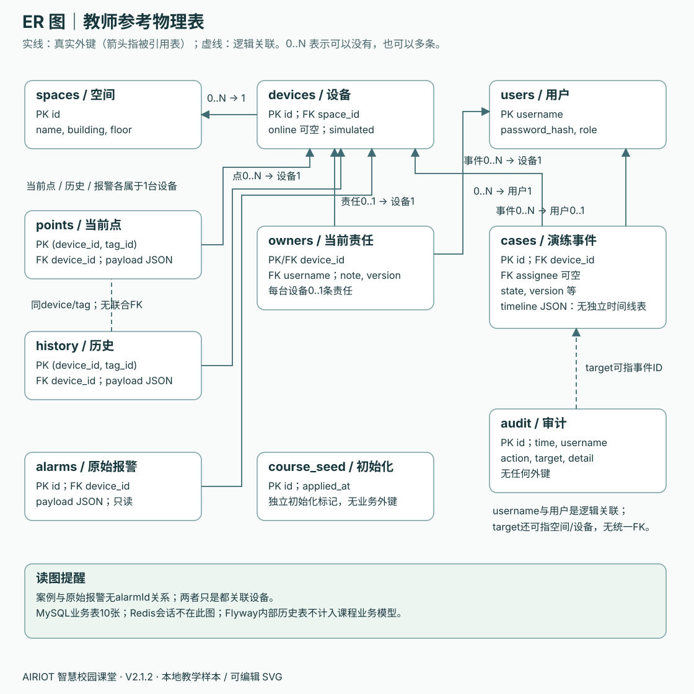
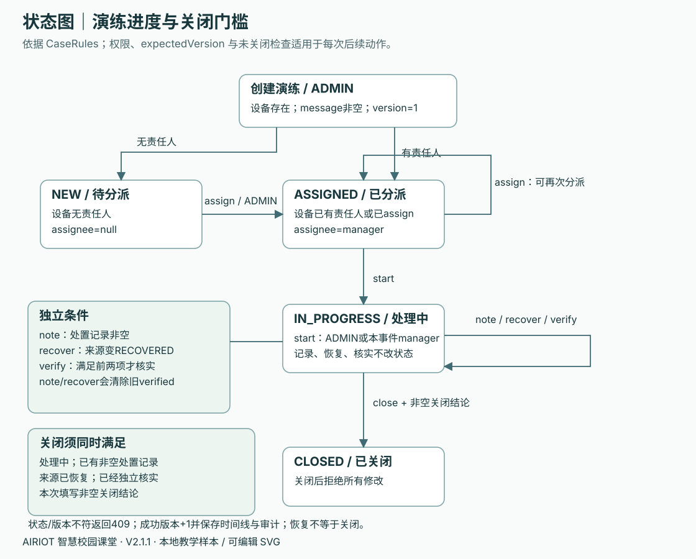

# 工程手册三：数据模型与字典 · V2.1.2

先确定记录代表什么、如何关联，再决定保存到哪张表。本页以教师参考的 `V1__course_tables.sql`、`SeedData.java`、`CampusService.java`、`CaseRules.java` 和公开 `mock-campus.json` 为依据。物理表、接口对象和概念对象分开标注，避免“图上画了一个对象，就以为数据库必有同名表”。

## 你要做什么

第02课第1步先画Space、Device、Point的概念关联；第07课整理页面数据时，指出每个菜单读写哪些对象；第08课第3步建表前，把Space/Device关系画成本人的ER图并对照V1；第11课实现事件前，对照已有状态图检查关闭条件。这些均在原有工程训练内完成。产出写入 `docs/模型说明.md` 的“数据模型核对”子节：本人ER图、自己实际迁移文件的表清单、一个0/null例子、一个版本冲突例子。后续只在涉及表和规则变化时修订，图未覆盖的部分列明范围，不要求一次画完全部系统。

验收：同伴随机给出 `deviceId`、`spaceId`、`assignee`、`timeline`，你能解释字段所指对象、空值含义、约束由数据库还是业务代码实施，并指出自己的实际文件。

## 1. 概念与物理关系

读图先问它回答哪一类问题，不能只看方框名称：

| 模型 | 回答的问题 | 本课例子与核对位置 |
| --- | --- | --- |
| 概念模型 | 业务里有哪些对象、它们有什么关系 | Space/Device/Point表达空间、设备、点位的含义；先对照需求和公开样本，不要求存在同名Java类 |
| 代码类模型 | 程序中实际有哪些类型、字段和调用依赖 | 对照自己的Java/JavaScript文件；参考的CaseRecord/User是Java类型，部分其他响应用Map，不据概念图虚构源码类 |
| 物理ER模型 | 实际有哪些表、键、空值和数量约束 | 对照自己的SQL迁移；参考的TimelineItem保存在cases.timeline JSON列中，不能画成已经存在的独立表 |

概念类示意见[架构与设计取舍](02-架构与设计取舍.md)，用例草图读法见[需求规格与用例](01-需求规格与用例.md)。二者帮助理解业务，下面的ER图则需要逐项和数据库实现核对。

本图中的方框是表，PK是唯一标识行的主键，FK是指向另一表键的外键；实线表示V1中真实存在的外键，虚线表示没有建立外键的逻辑关系。这是本图图例，不可将“实线就是外键”套到所有UML图。`1`表示恰好一个，`0..1`表示可以没有、最多一个，`0..N`表示可以没有或有多个；例如设备必须属于一个空间，而空间可以暂时没有设备。画自己的ER图时保留简短图例并与迁移核对，不要求先记住所有ER记法。

| 关系 | 基数与含义 | 参考数据库实际约束 |
| --- | --- | --- |
| Space → Device | 一个空间0..N设备；每台设备恰好1空间 | devices.space_id外键，NOT NULL |
| Device → Point / History / Alarm | 一台设备各有0..N条记录；每条属于1设备 | 三表device_id分别外键；Point/History以device_id+tag_id联合主键 |
| Device → Owner | 一台设备0..1条当前责任记录 | owners.device_id既是主键又是外键 |
| User → Owner | 一个用户可负责0..N设备；每条责任恰好1用户 | owners.username外键；业务只接受manager |
| Device → Case | 一台设备0..N个独立演练 | cases.device_id外键 |
| User → Case | 一个用户可分派0..N事件；事件0..1处理人 | cases.assignee可空外键 |
| Point ↔ History | 用同一deviceId/tagId理解对应点位和历史 | 没有history到points的联合外键，不能把它画成已存在的物理外键 |
| User / 业务对象 ↔ Audit | 通过username、action、target理解谁改了什么 | audit无外键；target是多种对象ID的文字，不是统一实体外键 |
| Case → TimelineItem | 一个事件包含多条动作记录 | 存在cases.timeline JSON中，没有独立timeline表 |
| Alarm ↔ Case | 可指向同一设备，含义不同 | 没有alarmId字段或报警转事件关系 |

## 2. 参考物理表字典

记号：PK=主键，FK=外键；未标“可空”的下列列均为NOT NULL或由主键约束非空。`VARCHAR(n)`的n是声明长度；API输入还有自己的长度限制。类型来自参考SQL，枚举规则多由业务代码决定，不能误说SQL建立了CHECK约束。

| 表 | 列、类型与约束 | 用途 |
| --- | --- | --- |
| spaces | id VARCHAR(32) PK；name VARCHAR(120)；building VARCHAR(120)；floor VARCHAR(40) | 4个空间；楼层是文本，允许“1”等表达，不做整数计算 |
| devices | id VARCHAR(32) PK；name VARCHAR(120)；category VARCHAR(40)；space_id VARCHAR(32) FK；online BOOLEAN 可空；simulated BOOLEAN DEFAULT TRUE | 16台样本设备；online空值表示未知 |
| points | device_id VARCHAR(32) FK；tag_id VARCHAR(64)；二者联合PK；payload JSON | 当前点位样本，payload内有值、单位、时间和质量 |
| history | device_id VARCHAR(32) FK；tag_id VARCHAR(64)；二者联合PK；payload JSON | 一个设备点位的一段历史放在一个JSON对象中，并非一行一个采样 |
| alarms | id VARCHAR(32) PK；device_id VARCHAR(32) FK；payload JSON | 只读原始教学报警；公开样本现有1条 |
| users | username VARCHAR(40) PK；password_hash VARCHAR(100)；role VARCHAR(20) | 本地3账号及BCrypt摘要；摘要不出现在API |
| owners | device_id VARCHAR(32) PK/FK；username VARCHAR(40) FK；note VARCHAR(500)；version BIGINT | 每台设备最多1条当前责任；首次保存版本1 |
| cases | id VARCHAR(40) PK；device_id VARCHAR(32) FK；message VARCHAR(500)；state VARCHAR(20)；assignee VARCHAR(40) 可空FK；source_state VARCHAR(20)；verified BOOLEAN DEFAULT FALSE；note VARCHAR(2000)；conclusion VARCHAR(2000)；version BIGINT；timeline JSON | 演练当前快照与内嵌动作历史 |
| audit | id BIGINT AUTO_INCREMENT PK；time BIGINT；username VARCHAR(40)；action VARCHAR(60)；target VARCHAR(80)；detail VARCHAR(2000) | 业务成功修改的审计；时间为epoch毫秒，无用户外键 |
| course_seed | id VARCHAR(40) PK；applied_at TIMESTAMP DEFAULT CURRENT_TIMESTAMP | 教师参考样本初始化标记，不是业务菜单、会话或学生打卡表 |

Flyway还维护自己的迁移历史表，它不属于上面10张课程表。教师参考通过 `SeedData` 在首次初始化事务中读公开JSON，写4空间、16设备、28当前点、28历史对象、1报警和3账号，再写初始化标记。初始owners/cases/audit为空。修改本地.env口令不会自动修改已初始化数据库的账号，不能反复随机口令后连接旧卷。

## 3. 接口字段与保存字段的区别

| 对象 | API/公开样本字段 | 空值、含义与限制 |
| --- | --- | --- |
| Space | id, name, building, floor | 字符串；编辑只允许building/floor，不能由该接口改id/name |
| Device | id, name, category, spaceId, online, simulated | spaceId映射space_id；四类environment/energy/facility/lighting；online为true/false/null |
| Point | deviceId, tagId, value, unit, time, quality | value为number/null；time为epoch毫秒/null；quality=fresh/stale/missing/invalid；保留原含义 |
| History | deviceId, tagId, unit, samples:[{time,value}] | 样本value允许null；0是有效值；本包time为epoch毫秒；不补造采样 |
| Alarm | id, deviceId, message, status, level, time, simulated | status/level保留原样，例如SAMPLE_ACTIVE/NOTICE；不能用演练状态覆盖 |
| User | username, role | role为ADMIN/MANAGER/VIEWER；API不含password_hash |
| Owner | deviceId, username, note, version | 无责任记录时GET列表不包含它；不是返回version=0的虚构行；首次写请求使用0 |
| CaseRecord | id, deviceId, message, state, assignee, sourceState, verified, note, conclusion, version, timeline | assignee可null；sourceState对应source_state；创建version=1，note/conclusion为空字符串 |
| TimelineItem | time, username, action, note, version | 后端每次成功动作追加；创建action=create；保存在同一事件JSON数组中 |
| Audit | id, time, username, action, target, detail | action包括space.update、owner.update、case.create、case.assign等；最新id优先返回 |

数据库中的 `payload` 是整个公开Point/History/Alarm对象。服务将JSON解码后返回这些字段，不把payload字符串直接发给页面。公开文件顶层有source/simulated/observedAt，但教师参考 `/api/overview` 只返回spaces/devices/points/history/alarms五集合；总体来源通过 `/api/integration` 提供，不能要求前端读取后端没有返回的顶层字段。

当前样本点位：环境设备temperature(°C)/humidity(%)；能源设备power(kW)/voltage(V)；设施status(空单位)；照明status(空单位)/brightness(%)。时间戳是样本采样时间，不能用页面刷新时间覆盖。JSON number在JavaScript中有精度边界，课堂版本很小；对极大BIGINT不能假定浏览器都能精确运算。

## 4. 事件状态与独立条件

`state`表示工作进度；`sourceState`表示演练来源状态；`verified`表示是否独立核实。三者不同：来源恢复不会自动关闭，恢复后仍需要核实，核实后仍需要关闭结论。

状态图从一个状态框沿箭头读到下一状态，箭头标动作与成立条件；同一状态上的动作仍可能改字段和版本。时序图则从上往下读时间，竖向生命线代表参与模块，横向箭头表示请求或返回；它描述一次交互，不表示数据库外键。第06课的本人状态图和第07/09课的本人请求时序图沿用现有记录，按各自图例阅读，不能只连箭头而省略角色、条件或失败分支。

| 动作 | 允许角色与前置状态 | 成功后的变化 | 关键拒绝条件 |
| --- | --- | --- | --- |
| create | ADMIN；设备存在 | 有责任人→ASSIGNED，否则NEW；sourceState=ACTIVE，verified=false，version=1 | 空message/未知设备/无权限 |
| assign | ADMIN；NEW或ASSIGNED；username=manager；非空note | state=ASSIGNED、assignee=manager | 开始后不能重分派；不能分派给viewer |
| start | ADMIN或本事件manager；ASSIGNED | state=IN_PROGRESS | 未分派不能开始 |
| note | ADMIN或本事件manager；IN_PROGRESS；非空note | 更新处置记录；verified=false | 不能用空记录通过关闭门槛 |
| recover | ADMIN；IN_PROGRESS | sourceState=RECOVERED；verified=false；state不变 | 只模拟恢复，不操作设备 |
| verify | ADMIN或本事件manager；IN_PROGRESS、有处置记录、RECOVERED | verified=true；state不变 | 不接受客户端直接传verified=true替代动作 |
| close | ADMIN或本事件manager；IN_PROGRESS、有处置记录、RECOVERED、已核实、请求note为非空结论 | conclusion保存结论；state=CLOSED | 缺任何条件不得关闭；关闭后拒绝全部修改 |

除create外，每个动作要求expectedVersion与当前版本一致；成功版本加1并写timeline和audit，失败不增版本。恢复或重新编辑处置记录会清除旧核实结果，因此需要再次verify。参考的assign允许在ASSIGNED阶段再次分派给manager，不把图简化成“这个状态下没有任何可写动作”。

## 5. 教师一次建表与学生分步迁移

| 材料 | 实际安排 | 学生如何使用 |
| --- | --- | --- |
| teacher-reference | V1一次建立上面10表；timeline为JSON列；SeedData首次填样本 | 用于最终模型对照，不能拿它覆盖已经执行过的学生V1 |
| 第08课学生工程 | V1先建spaces/devices并填公开样本 | 先验证设备真实读取与持久保存 |
| 第09课学生工程 | V2增加users；登录会话在Redis | 不把会话表塞进MySQL来冒充课程Redis实验 |
| 第10课学生工程 | V3补读数/历史/报警/责任等 | 依据自己的实际迁移核对字段与API，不重复建已存在表 |
| 第11课学生工程 | V4补事件、时间线与审计保存 | 可独立时间线表，也可JSON；必须满足同一事务、顺序和响应合同，写清自己的物理方案 |

因此，教师ER图是明确标注的参考物理模型；学生应提交与自己SQL一致的图。若把timeline拆成表，需要明确case_id、顺序/版本、外键与事务策略；不能既在图中画了表又只在代码中写JSON。变更已应用结构要新增迁移，不能为通过检查删库重建。

## 6. 本页验收

提交前逐项核对：图的每条实线在自己的SQL里真有外键；一台设备为何最多一条owner；无负责人事件的assignee为何可空；history为什么有28个对象而不代表只有28个采样；0/null与采样时间如何显示；一次失败动作为什么不应多出timeline；课堂JSON简化有什么代价。

把至少一个实际查询/接口截图或脱敏JSON证据附到自己的记录，注明数据来源和时间；不要附口令、令牌、真实.env或完整登录响应。[API手册](04-API接口手册.md)给出请求/响应例，图示的可编辑源和重建脚本位于同目录 `figures/`。用[模型说明记录](templates/模型说明记录.md)注明图的覆盖范围、参考来源、本人改画与实现核对；教师SVG可作对照，不能原样复制后冒充自己的建模成果。
