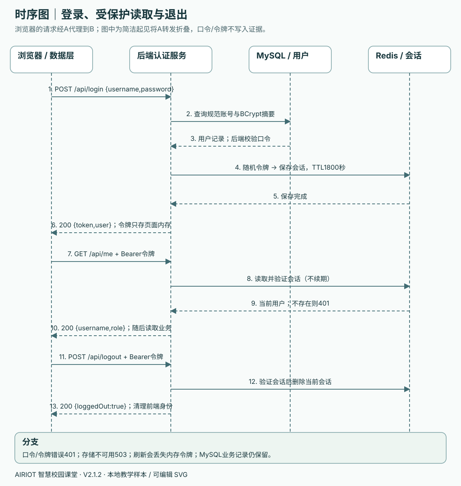
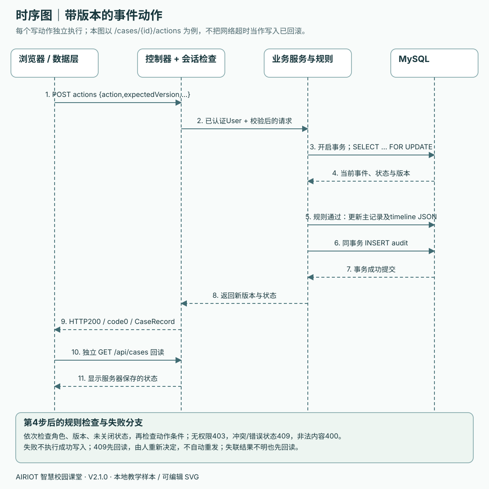

# 工程手册四：API接口手册 · V2.1.0

本手册说明 `resources/from-zero-v2/teacher-reference` 的最终后端，供学生在第 07—11 课查阅和联调。共 **14 个路径、15 个 HTTP 操作**，均以 `/api` 开头。第 08 课学生工程的设备接口可暂时公开；第 09 课加入登录后，除 `health` 和 `login` 外全部需要登录。教师参考工程已经采用后一种权限范围。

机器可读合同见 [openapi.json](openapi.json)，版本为 OpenAPI 3.1.0；可导入支持该版本的接口工具。工程没有安装 Swagger UI，也没有 `/v3/api-docs` 接口。以下口令、令牌、时间、ID 和响应都是**教学示例，不是运行证据**，尖括号中的口令/令牌是公开文档的脱敏占位，真实响应中会是随机令牌，不能把占位文字直接发给接口。

## 学生要做什么、留下什么、怎样验收

在原有课次里完成下列工作，不增加课次或替代手把手操作：

| 对应课次 | 学生亲自做什么 | 留下的产出 | 验收方式 |
| --- | --- | --- | --- |
| 第 07 课 | 找到健康接口的 URL、方法、状态码、响应体 | 在本组实做记录中解释 `HTTP 200` 与 `code:0` | 能说明健康成功不代表数据库已经读写成功 |
| 第 09 课 | 登录后读取身份，再退出并重复读取身份 | 一组去除口令与令牌的请求/响应记录 | 登录、读取身份成功；退出后旧会话返回 401 |
| 第 10 课 | 用当前版本登记责任，再用旧版本提交 | 一次成功和一次 409 的记录 | 冲突时不覆盖新值；重新 GET 后由学生决定 |
| 第 11 课 | 对照状态表走完事件，故意尝试无权操作和提前关闭 | 动作顺序、每次版本、一次 403 和一次 409 | 关闭门槛满足才成功；失败不改变事件版本/时间线 |
| 第 11 课 | 向两个版本字段接口发送非法原始 JSON | 按文末版本检查表填写实际结果 | 非法版本返回 400 且业务记录不变 |

记录方法、路径、角色、输入、HTTP 状态、`code`、关键返回字段与实际结果。口令和 Bearer 值不进入截图、Git 或作业附件。返回“成功”后还要 GET 回读相应列表，核对数据库中的最新值。

## 1. 地址、登录和统一响应

浏览器页面地址为 `http://127.0.0.1:5188`，前端以 `/api/...` 同源请求，Node 页面服务转发到 `http://127.0.0.1:8098/api/...`。本机接口工具也可直接请求后端地址。本文各接口表列的是完整 `/api` 路径；OpenAPI 的 `servers` 已含 `/api`，导入后不要再加一遍。

带 JSON 的请求使用 `Content-Type: application/json`。登录后发送：

```http
Authorization: Bearer <本机登录返回的令牌>
```

`Bearer` 大小写及其后的一个空格要保留。令牌是 32 个随机字节编码出的 43 字符 Base64URL 字符串，不是 JWT。Redis 会话有效期为 **1800 秒**；读取接口不续期，没有刷新令牌接口。参考前端只在内存保存令牌，刷新页面后重新登录。

本地教学账号为 `admin / ADMIN`、`manager / MANAGER`、`viewer / VIEWER`。初次初始化口令来自本机配置，数据库保存 BCrypt 哈希；登录响应不返回口令或哈希。会话里的用户名取自数据库记录，不能把用户输入的大小写形式当作权限身份。

所有成功操作（包括创建、更新和退出）都返回 **HTTP 200**：

```json
{"code":0,"message":"ok","data":{"status":"UP"}}
```

由后端统一错误处理器返回的失败，其 **HTTP 状态与 `code` 同值，`data` 为 `null`**：

```json
{"code":401,"message":"请先登录","data":null}
```

API 模式前端同时检查 HTTP 状态及 `code===0`。网络中断或前端等待超过 5 秒时，`data-service.js` 会在浏览器内部产生状态 503 的异常；这时可能根本没有后端 HTTP 响应，不能与服务器返回的 503 JSON 混为一谈。



调用顺序：`POST /api/login` → 取出 `data.token` → 用该令牌 `GET /api/me` → 读取业务接口 → `POST /api/logout`。退出也要求有效会话；令牌已过期时会先返回 401。

## 2. 接口总表

“全部角色”均指已经登录的 ADMIN、MANAGER、VIEWER。

| 方法 | 完整路径 | 用途 | 角色/范围 |
| --- | --- | --- | --- |
| GET | `/api/health` | 后端健康状态 | 公开 |
| POST | `/api/login` | 创建短时登录会话 | 公开 |
| POST | `/api/logout` | 删除当前会话 | 全部角色 |
| GET | `/api/me` | 当前身份 | 全部角色 |
| GET | `/api/devices` | 设备数组 | 全部角色 |
| GET | `/api/overview` | 空间、设备、读数、历史、报警集合 | 全部角色 |
| GET | `/api/spaces` | 空间数组 | 全部角色 |
| PUT | `/api/spaces/{id}` | 修改楼栋和楼层 | ADMIN |
| GET | `/api/owners` | 已登记的责任记录 | 全部角色 |
| PUT | `/api/owners/{deviceId}` | 登记/修改责任人 | ADMIN |
| GET | `/api/cases` | 全部演练事件及时间线 | 全部角色 |
| POST | `/api/cases` | 创建演练 | ADMIN |
| POST | `/api/cases/{id}/actions` | 六种演练动作 | 见动作表 |
| GET | `/api/audit` | 成功业务写入审计 | ADMIN |
| GET | `/api/integration` | 教学来源与功能开关 | 全部角色 |

这些读取接口没有分页、搜索或过滤参数。没有单条事件详情接口；事件详情从 `GET /api/cases` 结果中按 ID 查找。也没有独立的 `/api/points`、`/api/history`、`/api/alarms`，这些数据来自 overview。没有原始报警写入、实际设备控制或外部通知接口。

## 3. 请求字段与数据类型

“必填文本”不得为 `null`、空字符串或全空白；长度上限在去除首尾空白之前检查。除登录口令外，服务按各操作将保存的说明、楼栋和楼层去除首尾空白。登录账号/口令不会由接口主动 trim。路径 ID 直接使用读取或创建接口返回的值。

| 请求 | 字段 | 类型与限制 |
| --- | --- | --- |
| 登录 | `username`、`password` | 必填文本，分别最多 40、64 字符 |
| 修改空间 | `building`、`floor` | 必填文本，分别最多 120、40 字符；楼层是字符串 |
| 登记责任 | `username` | 必填文本，最多 40 字符，当前课程只接受 `manager` |
| 登记责任 | `note` | 必填文本，最多 500 字符 |
| 登记责任 | `expectedVersion` | 必填原始 JSON 非负整数；未登记时为 0 |
| 创建演练 | `deviceId`、`message` | 必填文本，分别最多 32、500 字符 |
| 演练动作 | `action` | 必填文本，最多 20 字符；只支持动作表中的六个值 |
| 演练动作 | `expectedVersion` | 必填原始 JSON 非负整数，必须等于当前事件版本 |
| 演练动作 | `note` | 最多 2000 字符；assign、note、close 必填，其余动作可缺省或为 null |
| 演练动作 | `username` | 最多 40 字符；assign 必填且为 `manager`，其他动作可缺省或为 null，不用于变更处理人 |

`expectedVersion` 的范围为 `0` 至 `9223372036854775807`（Java long）。不得传 `"1"`、`1.0`、`1.5`、`true`、`null`、缺省、负数或超出范围值。请求发的是从 GET 得到的当前版本，不能在提交前自行加 1。浏览器处理极大整数还有精度限制，本课版本应通过正常操作逐次产生，不手工构造超大有效版本。

V2.1 参考工程在 `JsonInputConfig.java` 禁用浮点数、字符串、空字符串和布尔值向整数的自动转换；`VersionJsonBoundaryTest.java` 用原始 JSON 经 MockMvc 检查两个写入口的非法版本及缺省版本，确认返回 400 且未调用业务服务。该测试还检查责任写入口的 0、1、long 最大值能原样进入服务。这是请求边界测试，不能替代实际 MySQL/Redis 联调。

OpenAPI 用整数类型表达上述合同，但 JSON Schema 把数学值为整数的 `1.0` 也视为 integer，不能代替对原始请求文本的检查。不承诺后端会拒绝所有额外未知字段；学生只发送本表声明的字段，不能依靠附加 `role`、`state` 或 `verified` 改写服务端身份/状态。

### 主要响应对象

| 对象 | 字段与含义 |
| --- | --- |
| User | `username:string`、`role:ADMIN/MANAGER/VIEWER` |
| Space | `id/name/building/floor:string` |
| Device | `id/name/category/spaceId:string`、`online:boolean|null`、`simulated:true`；category 为 environment/energy/facility/lighting |
| Point | `deviceId/tagId/unit:string`、`value:number|null`、`time:毫秒时间戳|null`、`quality:fresh/stale/missing/invalid` |
| History | `deviceId/tagId/unit:string`、`samples:[{time:毫秒时间戳,value:number|null}]` |
| Alarm | `id/deviceId/message/status/level:string`、`time:毫秒时间戳`、`simulated:true` |
| Owner | `deviceId/username/note:string`、`version:整数` |
| CaseRecord | `id/deviceId/message/state/sourceState/note/conclusion:string`、`assignee:string|null`、`verified:boolean`、`version:整数`、`timeline:数组` |
| 时间线项 | `time:毫秒时间戳`、`username/action/note:string`、`version:整数` |
| Audit | `id/time:整数`、`username/action/target/detail:string` |

`online:null` 是未知；读数 `null` 不是 0；功率 kW、电压 V 不是电量 kWh。overview 的后端响应只有五个数组，没有样本文件根部的 `source`、`simulated`、`observedAt` 字段。接入标识应读取 integration。

## 4. 逐接口请求与响应

以下数组示例只展示一条结构，overview 也缩短为每类一条，实际响应会返回数据库中的完整数组；不要把示例条数当作验收总数。参考初始教学数据是 4 个空间、16 台设备、28 个读数、28 条历史序列和 1 条样本报警，责任/事件/审计初始为空。全部完整教学示例见 OpenAPI。

### `GET /api/health` — 查看后端健康状态

公开，仅检查请求到达后端，不查询 MySQL/Redis。 所有示例均为教学构造值。

请求体：无。

成功响应（HTTP 200）：

```json
{"code":0,"message":"ok","data":{"status":"UP"}}
```

失败响应：`500`；对应 JSON、触发条件与处理方式见第 6 节。

### `POST /api/login` — 教学账号登录

公开。数据库验证 BCrypt 口令，Redis 保存随机会话，固定 TTL 1800 秒；返回规范账号名。示例口令和令牌均不可使用。 所有示例均为教学构造值。

请求体：

```json
{"username":"admin","password":"<本机DEMO_PASSWORD>"}
```

成功响应（HTTP 200）：

```json
{"code":0,"message":"ok","data":{"token":"<本机登录返回的令牌>","user":{"username":"admin","role":"ADMIN"}}}
```

失败响应：`400`、`401`、`500`、`503`；对应 JSON、触发条件与处理方式见第 6 节。

### `POST /api/logout` — 退出当前会话

需要有效会话，删除当前 Redis key，无请求体；无效/过期会话先返回 401。 所有示例均为教学构造值。

请求体：无。

成功响应（HTTP 200）：

```json
{"code":0,"message":"ok","data":{"loggedOut":true}}
```

失败响应：`401`、`500`、`503`；对应 JSON、触发条件与处理方式见第 6 节。

### `GET /api/me` — 读取当前身份

所有登录角色；返回 Redis 会话身份，读取不续期。 所有示例均为教学构造值。

请求体：无。

成功响应（HTTP 200）：

```json
{"code":0,"message":"ok","data":{"username":"manager","role":"MANAGER"}}
```

失败响应：`401`、`500`、`503`；对应 JSON、触发条件与处理方式见第 6 节。

### `GET /api/devices` — 读取设备台账

最终参考实现需登录，按 id 排序，无分页/过滤；第 08 课可暂公开，第 09 课后鉴权。 所有示例均为教学构造值。

请求体：无。

成功响应（HTTP 200）：

```json
{"code":0,"message":"ok","data":[{"id":"d01","name":"温湿度01","category":"environment","spaceId":"s1","online":true,"simulated":true}]}
```

失败响应：`401`、`500`、`503`；对应 JSON、触发条件与处理方式见第 6 节。

### `GET /api/overview` — 读取教学数据集合

所有登录角色。包含五类数组；没有独立 points/history/alarms 接口。原始报警只读。保留 null、0、采样时间和质量。 所有示例均为教学构造值。

请求体：无。

成功响应（HTTP 200）：

```json
{"code":0,"message":"ok","data":{"spaces":[{"id":"s1","name":"101教室","building":"教学楼","floor":"1"}],"devices":[{"id":"d01","name":"温湿度01","category":"environment","spaceId":"s1","online":true,"simulated":true}],"points":[{"deviceId":"d01","tagId":"temperature","value":24.0,"unit":"°C","time":1792454400000,"quality":"fresh"}],"history":[{"deviceId":"d01","tagId":"temperature","unit":"°C","samples":[{"time":1792452900000,"value":24.0},{"time":1792453200000,"value":24.0}]}],"alarms":[{"id":"a01","deviceId":"d01","message":"教学样本：温度提醒；不表示真实校园故障","status":"SAMPLE_ACTIVE","level":"NOTICE","time":1792454400000,"simulated":true}]}}
```

失败响应：`401`、`500`、`503`；对应 JSON、触发条件与处理方式见第 6 节。

### `GET /api/spaces` — 读取空间

所有登录角色，按 id 排序。 所有示例均为教学构造值。

请求体：无。

成功响应（HTTP 200）：

```json
{"code":0,"message":"ok","data":[{"id":"s1","name":"101教室","building":"教学楼","floor":"1"}]}
```

失败响应：`401`、`500`、`503`；对应 JSON、触发条件与处理方式见第 6 节。

### `PUT /api/spaces/{id}` — 修改空间楼栋和楼层

仅 ADMIN。字符串去首尾空白；不改名称；无版本校验，成功写审计。 所有示例均为教学构造值。

路径参数：`id`，取已有记录的标识。

请求体：

```json
{"building":"教学楼A","floor":"1"}
```

成功响应（HTTP 200）：

```json
{"code":0,"message":"ok","data":{"id":"s1","name":"101教室","building":"教学楼A","floor":"1"}}
```

失败响应：`400`、`401`、`403`、`404`、`500`、`503`；对应 JSON、触发条件与处理方式见第 6 节。

### `GET /api/owners` — 读取设备责任记录

所有登录角色，按 device_id 排序。初始为空，未登记设备不补 version=0 行。 所有示例均为教学构造值。

请求体：无。

成功响应（HTTP 200）：

```json
{"code":0,"message":"ok","data":[]}
```

失败响应：`401`、`500`、`503`；对应 JSON、触发条件与处理方式见第 6 节。

### `PUT /api/owners/{deviceId}` — 登记或修改设备责任

仅 ADMIN，username=manager。已有设备；责任未登记时 expectedVersion=0，否则使用回读版本。成功加 1；不重新分派旧事件。 所有示例均为教学构造值。

路径参数：`deviceId`，取已有记录的标识。

请求体：

```json
{"username":"manager","note":"本课巡查负责人","expectedVersion":0}
```

成功响应（HTTP 200）：

```json
{"code":0,"message":"ok","data":{"deviceId":"d01","username":"manager","note":"本课巡查负责人","version":1}}
```

失败响应：`400`、`401`、`403`、`404`、`409`、`500`、`503`；对应 JSON、触发条件与处理方式见第 6 节。

### `GET /api/cases` — 读取演练及时间线

所有登录角色读取全部事件；本人范围仅限制 MANAGER 写入。按字符串 id 降序，不能当作创建时间排序；无分页或单条详情接口。 所有示例均为教学构造值。

请求体：无。

成功响应（HTTP 200）：

```json
{"code":0,"message":"ok","data":[]}
```

失败响应：`401`、`500`、`503`；对应 JSON、触发条件与处理方式见第 6 节。

### `POST /api/cases` — 创建本地演练

仅 ADMIN。已有责任人自动 ASSIGNED，否则 NEW；version=1，来源 ACTIVE，未核验。事务写入事件和审计；不改原始报警。 所有示例均为教学构造值。

请求体：

```json
{"deviceId":"d01","message":"课堂演练：检查样本温度"}
```

成功响应（HTTP 200）：

```json
{"code":0,"message":"ok","data":{"id":"00000000-0000-4000-8000-000000000001","deviceId":"d01","message":"课堂演练：检查样本温度","state":"NEW","assignee":null,"sourceState":"ACTIVE","verified":false,"note":"","conclusion":"","version":1,"timeline":[{"time":1792454400000,"username":"admin","action":"create","note":"仅课堂演练，不是上游报警","version":1}]}}
```

失败响应：`400`、`401`、`403`、`404`、`500`、`503`；对应 JSON、触发条件与处理方式见第 6 节。

### `POST /api/cases/{id}/actions` — 推进演练动作

权限→版本→已关闭检查→动作条件。成功版本加 1，保存事件、时间线、审计于同一事务。409 后 GET /cases 并重新决定，不能自动重发。六组示例由无责任人的 NEW v1 连续到 CLOSED v7。 所有示例均为教学构造值。

路径参数：`id`，取已有记录的标识。

六种请求见下一节动作表；机器合同保存了六组完整请求与返回示例。这里以分派为例。

请求体：

```json
{"action":"assign","expectedVersion":1,"username":"manager","note":"请进行课堂巡查"}
```

成功响应（HTTP 200）：

```json
{"code":0,"message":"ok","data":{"id":"00000000-0000-4000-8000-000000000001","deviceId":"d01","message":"课堂演练：检查样本温度","state":"ASSIGNED","assignee":"manager","sourceState":"ACTIVE","verified":false,"note":"","conclusion":"","version":2,"timeline":[{"time":1792454400000,"username":"admin","action":"create","note":"仅课堂演练，不是上游报警","version":1},{"time":1792454460000,"username":"admin","action":"assign","note":"请进行课堂巡查","version":2}]}}
```

失败响应：`400`、`401`、`403`、`404`、`409`、`500`、`503`；对应 JSON、触发条件与处理方式见第 6 节。

### `GET /api/audit` — 读取成功业务写入审计

仅 ADMIN，按 id 降序。字段为 detail；当前实现不记录登录、读取或失败请求。 所有示例均为教学构造值。

请求体：无。

成功响应（HTTP 200）：

```json
{"code":0,"message":"ok","data":[]}
```

失败响应：`401`、`403`、`500`、`503`；对应 JSON、触发条件与处理方式见第 6 节。

### `GET /api/integration` — 读取教学接入标识

所有登录角色，固定教学状态，不探测真实 AIRIOT。登录仍依赖 Redis。 所有示例均为教学构造值。

请求体：无。

成功响应（HTTP 200）：

```json
{"code":0,"message":"ok","data":{"source":"TEACHING_MOCK","simulated":true,"controlEnabled":false,"notificationsEnabled":false}}
```

失败响应：`401`、`500`、`503`；对应 JSON、触发条件与处理方式见第 6 节。

## 5. 演练状态、动作和调用顺序

新建事件不带 `expectedVersion`，初始 `version=1`。已有设备责任人时直接进入 `ASSIGNED`，否则为 `NEW`、`assignee=null`。之后责任人登记发生变化，不会替旧事件重新分派。



业务状态 `state` 与来源状态 `sourceState` 分开：处置记录、来源恢复、核验、关闭是四件事。来源恢复只作用于本地演练，不修改 overview 中的原始报警。

| action | 谁可以做 | 前置条件（还须版本一致、未关闭） | 请求中的额外必填字段 | 成功变化 |
| --- | --- | --- | --- | --- |
| `assign` | ADMIN | NEW 或 ASSIGNED | `username:"manager"`、非空 `note` | assignee=manager；state=ASSIGNED |
| `start` | ADMIN；已分派给本人的 MANAGER | ASSIGNED | 无 | state=IN_PROGRESS |
| `note` | ADMIN；已分派给本人的 MANAGER | IN_PROGRESS | 非空 `note` | 覆盖处置记录；verified=false |
| `recover` | ADMIN | IN_PROGRESS | 无 | sourceState=RECOVERED；verified=false |
| `verify` | ADMIN；已分派给本人的 MANAGER | IN_PROGRESS、已有非空处置记录、来源 RECOVERED | 无 | verified=true |
| `close` | ADMIN；已分派给本人的 MANAGER | IN_PROGRESS、已有非空处置记录、来源 RECOVERED、verified=true | 非空 `note`，作为关闭结论 | conclusion=note；state=CLOSED |

每次成功动作都加 1 版本并追加时间线；事件与审计在同一个事务保存。重复 recover 也会加版本并取消原有核验；重复 verify 也会加版本。改写处置记录后需要重新核验。关闭后全部动作均拒绝。VIEWER 不能修改；MANAGER 虽能读取所有事件，却只能处理分派给自己的事件，且不能执行 assign/recover。

从**尚未登记责任人的设备**创建 NEW v1 后，可以依次提交以下教学请求；若创建时已自动 ASSIGNED，则从 start 开始，使用实际回读版本：

```json
{"action":"assign","expectedVersion":1,"username":"manager","note":"请进行课堂巡查"}
```

```json
{"action":"start","expectedVersion":2}
```

```json
{"action":"note","expectedVersion":3,"note":"已检查练习数据并记录处置"}
```

```json
{"action":"recover","expectedVersion":4}
```

```json
{"action":"verify","expectedVersion":5}
```

```json
{"action":"close","expectedVersion":6,"note":"课堂演练已独立核验并完成"}
```

上面每个代码块是一次独立 POST，不能把六段合成一个 JSON 请求体。assign/recover 使用管理员的会话，其余可使用被分派 manager 的会话。每次成功后用 `GET /api/cases` 回读，再决定下一步。这个顺序最终得到 CLOSED v7；ID、时间线时间以实际响应为准。

处理顺序也解释错误优先级：已登录后，先按事件 ID 找记录，再检查角色/本人范围，然后比较版本、检查是否已关闭，最后检查动作条件。所以无权者可能先收到 403，而不是同一请求中的版本 409；不存在的事件先收到 404。

## 6. 错误码、失败例与正确处理

后端只有数值 `code`，没有 `VERSION_CONFLICT` 等字符串错误码。下列是 `ApiErrors` 和业务代码实际使用的消息；OpenAPI 提供了完整错误示例集合。

| HTTP / code | 典型触发条件 | 教学失败响应（data 始终为 null） | 学生怎样处理 |
| --- | --- | --- | --- |
| 400 | 必填内容、长度、JSON 格式或版本类型无效 | `{"code":400,"message":"请检查输入：必填内容、长度和版本号必须符合要求","data":null}` | 修正输入后重新决定，不改成虚构成功 |
| 401 | 缺少 Bearer 头 | `{"code":401,"message":"请先登录","data":null}` | 重新登录，前端清除旧身份 |
| 401 | 登录口令不匹配 | `{"code":401,"message":"用户名或口令不正确","data":null}` | 核对本机配置，不能改为公开接口 |
| 401 | 会话 key 已过期/不存在 | `{"code":401,"message":"登录已过期，请重新登录","data":null}` | 重新登录，恢复会话后再读取 |
| 403 | 非管理员修改空间/责任、创建事件、查看审计、分派或恢复 | `{"code":403,"message":"这个操作需要管理员账户","data":null}` | 使用符合要求的教学角色 |
| 403 | VIEWER 写事件，或 MANAGER 写未分派给自己的事件 | `{"code":403,"message":"管理人员只能处理分派给自己的事件；查看者不能修改","data":null}` | 核对角色与 assignee；不伪造客户端角色 |
| 404 | 路径中的空间不存在 | `{"code":404,"message":"没有找到这个空间","data":null}` | GET 回读已有 ID |
| 404 | 设备/事件不存在 | message 分别为 `没有找到这个设备` / `没有找到这个演练事件` | 核对 ID，不新造不存在的记录 |
| 404 | 接口不存在 | `{"code":404,"message":"没有找到这个接口","data":null}` | 对照接口总表 |
| 405 | 已有接口不支持所用方法 | `{"code":405,"message":"这个接口不支持该操作","data":null}` | 核对 GET/POST/PUT |
| 409 | 责任版本不一致 | `{"code":409,"message":"责任记录已更新，请刷新后重新决定；不要直接重复提交","data":null}` | GET /owners，再由学生重新决定 |
| 409 | 事件版本不一致 | `{"code":409,"message":"记录已被更新，请刷新页面后重新决定；不要直接重复提交","data":null}` | GET /cases，再由学生重新决定 |
| 409 | 不满足关闭门槛 | `{"code":409,"message":"关闭前需要处置记录、来源恢复和单独核验","data":null}` | 对照动作表完成缺失条件 |
| 500 | 其他未分类的后端异常 | `{"code":500,"message":"后端处理失败，请在后端终端检查错误并联系教师","data":null}` | 查看本课程后端终端；不把内部堆栈显示给用户 |
| 503 | MySQL/Redis 数据访问异常 | `{"code":503,"message":"数据库或登录服务暂时不可用，请检查本课程 MySQL 和 Redis","data":null}` | 检查课程专属服务；不能将存储失败伪装成成功 |

不符合动作状态也返回 409，例如未分派就 start、未开始就 note/recover、开始后重新分派、已关闭再修改。满足关闭状态门槛但关闭结论为空，则是 **400 `请填写关闭结论`**。分派对象非 manager、分派说明为空、处置记录为空或未知动作也返回 400。缺少有效会话时，登录拦截可能先于接口参数或路由错误返回 401。

### 两类 409 怎样区分

版本冲突意味着你依据的记录已经旧了；状态冲突意味着这个决定当前不被允许。两者都应回读并重新判断。不要仅把 `expectedVersion` 改成最新数值后自动重放原动作，也不要失败后直接把界面状态改为“已完成”。

### 原始 JSON 版本验收表

在 `PUT /api/owners/{deviceId}` 和 `POST /api/cases/{id}/actions` 分别验证，使用有权限的账号、有效记录及其他合法字段，让错误只来自版本字段。先保存 GET 响应，失败后再 GET，比较版本和业务值。动作场景还要核对时间线未增加。

| expectedVersion 输入 | 预期 |
| --- | --- |
| 当前合法整数 | 在权限和业务状态也满足时成功 |
| 合法但过期的整数 | 409，记录不变 |
| `"1"`、`1.0`、`1.5`、`true`、`null`、缺省 | 400，记录不变 |
| `-1`、`9223372036854775808` | 400，记录不变 |

用接口工具发送原始 JSON 文本检查 `1.0`，不要先经 JavaScript `JSON.stringify`，否则它可能已经变成 `1`，失去反例意义。记录实测结果，不以 OpenAPI 校验通过代替后端行为验收。

## 7. 回到源码确认

以 `resources/from-zero-v2/teacher-reference/` 为基准：

- `backend/src/main/java/cn/campus/course/CampusController.java`：15 个 HTTP 操作及 DTO 字段。
- 同目录 `CampusService.java`、`CaseRules.java`、`User.java`：数据形状、事务、角色和状态约束。
- 同目录 `AuthService.java`、`WebConfig.java`：随机令牌、会话 TTL 与登录拦截范围。
- 同目录 `Api.java`、`ApiErrors.java`：统一成功/失败结构；`JsonInputConfig.java`：严格整数输入。
- 同目录 `SeedData.java` 及 `backend/src/main/resources/data/mock-campus.json`：初始账户与公开教学数据。
- `frontend/data-service.js`：前端请求、401 清理、超时和 mock/API 分支。

浏览器演示分支与真实后端分支的少数细节并不相同，例如 mock 审计用 `note`，后端用 `detail`；以本手册的后端合同核对 API 模式。成功写入审计包含空间更新、责任登记和事件动作；参考实现没有登录或失败请求审计，不要在验收中把未实现能力写成已完成。
